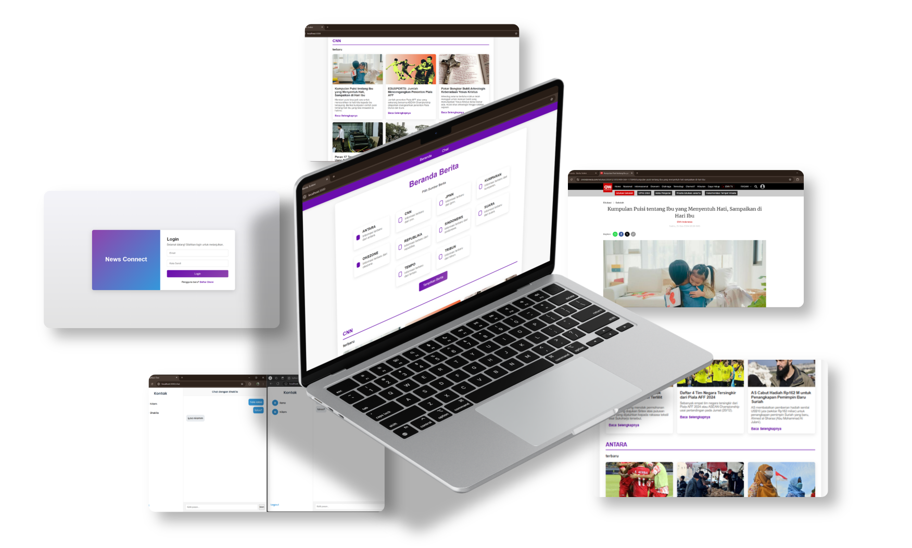

# News Connect 📰

A full-stack web application featuring a real-time news aggregator and an integrated instant messaging system. 

  

## 🚀 Key Features
*   **News Aggregation:** Fetches and categorizes real-time structured news data from multiple national sources using REST API integration.
*   **Secure Authentication:** User login and registration secured with **bcrypt** password hashing and **JWT** (JSON Web Tokens) authorization.
*   **Real-time Communication:** Built-in chat room enabling seamless instant messaging between registered users.
*   **Dynamic Filtering:** Users can effortlessly filter news feeds by specific publishers and categories.

## 🛠️ Tech Stack
*   **Backend Environment:** Node.js, Express.js
*   **Database:** MongoDB (Mongoose ODM)
*   **Authentication & Security:** JSON Web Token (JWT), bcryptjs
*   **API Integration:** Axios (REST API consumption)
*   **Frontend Templating:** EJS (Embedded JavaScript templating), CSS3

## 📂 Architecture Overview
Developed using the MVC (Model-View-Controller) architecture to ensure modularity, clean code, and scalable data flow between the MongoDB database, API controllers, and the EJS views.
